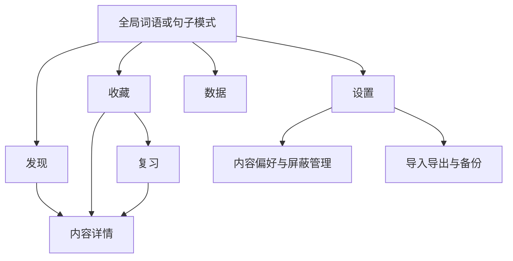

# 言间｜产品需求文档（PRD）

版本：V0.3 · 日期：2026-10-24 · 状态：开发基线草案  
项目：Android 中文表达学习 App · 产品名称「言间」为暂定名  
用途：供产品、设计、Android、内容编辑、测试接手；不代表所有功能已经实现。

## 1. 产品结论与定位

言间帮助用户把有美感、能说出口的中文表达用在日常聊天、情感表达和写作中。内容包含两字词、四字表达与完整句子，优先呈现中文电影、电视剧、纪录片中的真实原句和作品名称，书籍为补充，允许收录能说明具体字幕版本的外语作品中文字幕。

核心路径是「发现表达 → 理解词义与语境 → 收藏 → 主动回忆 → 间隔复习 → 生活中使用」。浏览可不限量，首页保持简洁；复杂解释放入详情，不把学习说明堆在卡片上。第一版围绕纯文字和本地使用展开，不以视频、社交或在线生成作为使用前提。

### 1.1 本文的证据等级

| 标记 | 含义 | 执行规则 |
| --- | --- | --- |
| 用户确认 | 当前可见对话中用户明确提出或确认 | 构成约束，修改须记录新的决定 |
| 执行方案 | 对确认需求的具体产品拆解，含此前助手建议 | 作为本轮开发默认方案，不冒充用户逐项确认 |
| 待实测 | 需要真实内容、设备或使用记录判断 | 保留明确验收方法，不能宣称已验证 |

本文依据本轮提供的历史对话整理。旧回复中出现的截图、HTML、数据集条数、影视台词核验说法，不自动视作当前项目已存在的文件或可发布内容；真实资产以工作目录和核验记录为准。

## 2. 已确认需求基线

| ID | 需求 | 来源状态 | 对交付的约束 |
| --- | --- | --- | --- |
| P-01 | 首版在 Android 手机运行 | 用户确认 | 正式产品目标为 Android，浏览器原型不等同 APK |
| P-02 | 主要改善日常聊天与情感表达 | 用户确认 | 优先选择可迁移到真实生活的表达 |
| P-03 | 既优美又实用，最终能主动说写 | 用户确认 | 内容需要简短解释、语境、适用方式与主动回忆 |
| P-04 | 词语与句子两个板块，顶部快速切换，整个界面切换 | 用户确认 | 切换改变内容模式、主题、收藏、复习与数据上下文 |
| P-05 | 词语浅色、句子深色；中间独立卡片；删除冗余解释 | 既有设计方向，用户要求继续改美观 | 保留简洁与卡片主角，新视觉须重新制作参考 |
| P-06 | 每天浏览数量不限 | 用户确认 | 不设置次数付费墙或强制每日任务；内容总量有限须诚实呈现 |
| P-07 | 需要真实影视或书籍原句，影视优先 | 用户确认 | 官方内容有可追溯原句和作品名，不以 AI 猜测出处 |
| P-08 | 首版先做原句和作品名称，原声与画面后续做 | 用户确认 | 不添加播放器、影片下载或音视频导入依赖 |
| P-09 | 句子默认实用 60%、经典/哲理/审美 40% | 用户确认 | 比例可调，允许选择类型板块 |
| P-10 | 中文作品优先，其他国家中文字幕也可 | 用户确认 | 记录语言、译文版本，不把不同译文冒充同一句 |
| P-11 | 复习顶部三区域同时服务分类与评分，但操作分离 | 用户确认 | 顶部筛选；底部评分；不能点击筛选即改变记忆状态 |
| P-12 | 复习翻面只显示简短释义，上滑看原句与详情 | 用户确认 | 卡片翻面不堆长篇解释或来源列表 |
| P-13 | 右上角设置再次点击应切回原页面 | 用户确认 | 设置是可反向切换的页面状态，保持来源页上下文 |
| P-14 | 数据直接放本地，不搭建数据库服务；现阶段纯文字 | 用户确认 | 首次安装后的核心浏览、收藏、复习、搜索可离线完成 |
| P-15 | 后续支持用户自定义导入，支持主流格式 | 用户确认 | 本轮把导入数据契约和预览机制设计清楚，格式按阶段落地 |
| P-16 | 文档放项目 docx 文件夹，扩展名 .md；图像放 img | 用户确认 | 不因目录名 docx 改用 Word 文件；生成图像必须归入项目 |
| P-17 | 旧前端不够美观，使用生图先做新的参考再推进 | 用户确认 | 新参考是视觉探索；实际界面仍须可点击、可读、可维护 |

## 3. 用户与典型使用场景

主要用户知道许多常见词，却经常在安慰、赞美、拒绝、道别或描述心情时找不到恰当表达。产品不要求用户先懂文学术语，也不把冷僻程度当作内容价值。

| 场景 | 用户目标 | 关键体验 |
| --- | --- | --- |
| 碎片时间随手浏览 | 遇见一个今天能用的表达 | 打开即卡片、随时结束、无学习任务弹窗 |
| 被一句台词打动 | 理解含义并保存 | 先看句子，按需展开作品名和上下文 |
| 准备表达安慰或遗憾 | 找回收藏中的合适表达 | 本地搜索与情绪分类，不依赖联网生成 |
| 每日短时复习 | 把熟悉变成可主动调用 | 先回忆后翻卡，评分决定后续安排 |
| 整理自己读到的内容 | 把个人词句纳入同一学习系统 | 文件导入、字段预览、来源标记、去重与撤销 |
| 换手机或更新内容库 | 保住收藏和记忆记录 | 用户备份与官方内容包升级互不覆盖 |

## 4. 首版范围与阶段

### 4.1 第一版产品范围（执行方案）

| 模块 | 第一版目标 | 不在本阶段完成的部分 |
| --- | --- | --- |
| 发现 | 词/句模式、随机推荐、上一条/下一条、翻卡、详情、收藏、屏蔽 | 社交信息流、广告、排行榜 |
| 收藏 | 搜索、分类、排序、详情、待复习入口、取消收藏 | 多人共享词本、云同步 |
| 复习 | 初学入口、到期队列、翻卡、详情、三等级评分、跳过、评分撤销 | 语音测评、AI 自动判分 |
| 数据 | 今日/7 日/30 日/全部、行为计数、当前掌握分布、实际趋势 | 数据不足时的个人记忆预测曲线 |
| 偏好 | 推荐类别与比例、屏蔽列表、导入导出、备份、内容说明 | 登录和会员系统 |
| 本地数据 | 预置内容、用户数据持久化、版本化内容包、稳定内容 ID | 数据库服务器、用户端实时 AI 接口 |
| 内容制作 | 本地编辑、出处核验、发布状态、批量检查、打包 | 自动认定版权、自动把 AI 出处当真 |

CSV、JSON、TXT 为首版导入执行方案；TSV、XLSX、Markdown 在数据结构稳定后扩展，SRT 作为后续独立能力。用户已要求主流格式，但未逐项确认首版格式清单，因此不得在验收或宣传中写成「首版已支持全部主流格式」。纯文本导入可先进入个人草稿，补齐释义后再参与遮答复习。

### 4.2 本次启动工作的完成定义

本轮先形成可以交接的文档，保存视觉参考与提示词，再以实际环境允许的方式启动实现。必须分别标注「已写入」「已可操作」「已运行验证」「仅规格」「尚未接入」，不能将视觉图、浏览器演示或计划误报为完整 Android 产品。

首批 300–500 个词语、100–200 个句子可作为内测建设目标；正式内容目标 1,000–1,500 个词语、300–500 个句子仍是估算。数量不是交付现状。任何内容未通过来源与发布审核，即使已录入数据库也不计入正式可推荐数量。

## 5. 产品结构

底部使用「发现、收藏、数据」三个入口；复习从收藏进入；设置从右上角进入并能原位关闭。词语与句子共用页面结构，分别保存内容游标、收藏和学习状态。

全局切换保持底部导航位置。例如在词语收藏中切换后，进入句子收藏。设置打开期间若允许切换模式，偏好编辑对象随模式更新，关闭后仍回到原底部页面；第一次进入某模式使用其默认状态，不复制另一模式的条目 ID。复习切换模式先保存队列位置，不给当前卡自动评分。

## 6. 内容产品标准

每条官方内容有稳定 ID、内容类型、展示文字、短释义、分类、适用语境、来源关系与发布状态。影视原句记录至少包含作品名、原句、核验依据；剧集、人物、时间码只在可以确认时填入。词的古籍出处与现代影视使用记录分开存储。

内容筛选同时考虑自然度、表达价值、可迁移性与重复度。「希冀」和「希望」等近义内容不能仅因语义接近被机械删除，差异体现在语体、情感或使用场景时可以并存。冷僻、陈旧、过度修辞的表达不自动获得高权重。

实用/经典是句子的主推荐分类，每条仅一个主分类，用于统计 6:4；安慰、拒绝、思念等多选标签用于个性化过滤。经典表达允许偏欣赏用途，必须在详情说明适用范围，不伪装成日常口语高频句。用户个人导入可以来源未知，明确标为个人内容；不能因填写了电影名字获得官方核验徽记。

## 7. 学习与推荐规则

收藏是进入学习体系的默认入口。新收藏未评分时处于内部状态「未学习」，不冒充「不熟悉」，也不计入已掌握。收藏页主按钮可显示「开始学习 N」或「开始复习 N」；若两者都有，默认先到期再初学，并在会话入口以简短数字说明。

复习中先看正面自行回忆，再翻面核对短释义，然后选择「不熟悉、熟悉、已会」。这是自评，不能被包装为真实语言能力检测。「已会」仍可被长期抽查。算法版本、评分时间和下一次到期时间需要可追溯，不能固定套用某张通用遗忘曲线。

推荐在符合当前模式、类型偏好、发布状态和屏蔽规则的内容池内抽取。短期尽量不重复，上一条支持回看。池耗尽后显示「本轮已看完」并允许开始下一轮，不能转圈假装持续产生新词。用户取消所有类别时阻止保存并提示至少选一类；某类内容不足时可以补充其他已选类，并短提示一次「部分类型内容不足」，不能突破用户明确未选类别。

## 8. 成功指标与统计口径

| 指标 | 定义 | 展示注意 |
| --- | --- | --- |
| 浏览数量 | 选定期间首次有效展示的不同内容 ID 数 | 返回上一张不重复累加；不与翻卡混计 |
| 完成复习次数 | 选定期间有效评分事件数，撤销事件抵扣 | 同卡在不同到期轮次可有多次；跳过不算 |
| 复习内容数 | 期间发生有效评分的不同内容 ID 数 | 与次数分开命名 |
| 新增收藏 | 期间首次从未收藏转为收藏的事件数 | 同日取消再收藏同一 ID 只计一次；当前收藏另列 |
| 当前收藏总量 | 当前仍收藏且未删除的条目数 | 属于当前存量，不因日期筛选误变成历史快照 |
| 当前掌握分布 | 当前收藏中各最新自评状态数量 | 未学习单列；无历史资料不推算过去分布 |
| 复习趋势 | 每日有效评分次数或内容数序列 | 有记录才画；缺记录日期显示 0，而不是预测 |

产品目标是主动运用，但在没有客观练习或真实场景证据前，不能把「已会比例」称为表达能力提升率。内测以用户能否说出含义、能否给出合适例句、能否快速找到收藏内容为重点；定量目标待真实使用后确定。

## 9. 非功能需求与发布约束

首版核心功能无需注册和持续联网。官方内容更新不覆盖用户收藏、掌握状态、屏蔽记录或用户导入。备份含用户内容、关联 ID、收藏、学习事件与偏好；卸载前的未备份数据无法承诺恢复。

所有可点击目标要适合手机触控；长句可滚动或合理缩放，不能用省略号截掉学习内容。提供减弱动态效果的实现入口，翻卡不能只依赖用户能看见动画。点击与上滑都有明确的可访问替代入口，手势不作为唯一操作方式。

App 内不放生成式 AI 密钥。AI 可以用于离线内容候选筛选和编辑辅助，但不能自动伪造出处、核验状态、学习记录、用户记忆预测。发布范围和引用授权由内容工作流单独处理，不用 AI 分数抵消发布门槛。

## 10. 发布验收与变更管理

| AC | 必须满足的验收条件 |
| --- | --- |
| AC-P01 | 飞行模式下可浏览预置内容、收藏、复习并重启恢复；不弹登录阻断 |
| AC-P02 | 顶部切换后主题及数据上下文同步变化，回切恢复各自浏览位置 |
| AC-P03 | 点击卡片翻面只见短释义，上滑详情可看原句与作品名；没有模拟来源冒充已核验 |
| AC-P04 | 顶部等级筛选不写评分；底部评分只在揭晓后可用，重复点击只写一次 |
| AC-P05 | 已会、熟悉、不熟悉、未学习口径清楚，跳过或回退不增加复习数 |
| AC-P06 | 设置同一图标可打开与关闭，关闭恢复来源页与卡片位置 |
| AC-P07 | 6:4 为默认推荐目标；改变类别与比例后生效；内容不足和池耗尽有确定行为 |
| AC-P08 | 用户导入先预览再提交；错误行可定位；重复策略和官方/个人来源区分清楚 |
| AC-P09 | 备份恢复不静默覆盖现有数据，完成后给出条目数与冲突处理结果 |
| AC-P10 | 实际已交付能力与文档状态一致，Android 可运行与原型可点击分别证明 |

修改需求时记录日期、需求 ID、旧决定、新决定、理由和受影响文档。视觉调整可在不改变确认交互的前提下迭代；改变内容模式、评分含义、隐私边界或文件存储方式须明确标注。用户本轮已授权文档化、生成新视觉参考并开始开发，无需为常规可逆实现反复确认。

关联文档：[功能规格](02-功能规格.md) · [交互流程](03-交互流程.md)
