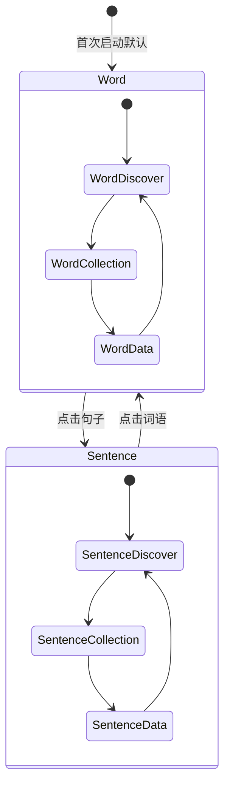
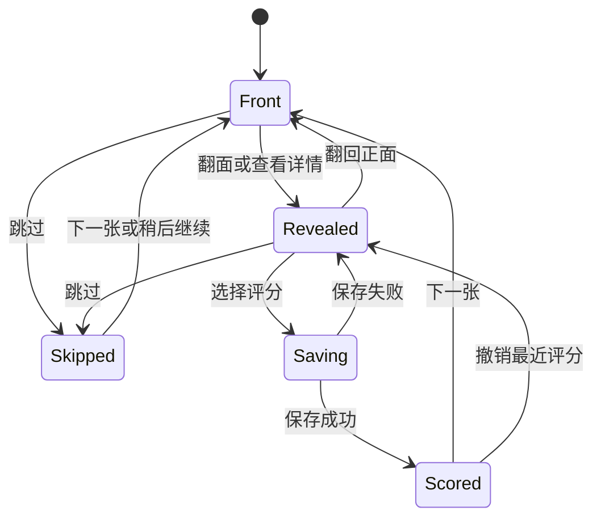
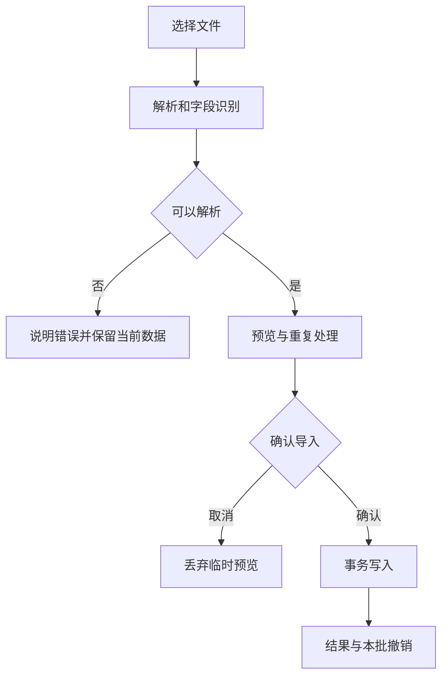

# 言间｜信息架构、交互流程与状态约定

版本：V0.3 · 日期：2026-10-24 · 状态：设计与前端共同基线  
关联：[PRD](01-PRD.md) · [功能规格](02-功能规格.md)  
说明：页面行为优先于概念图文字；生图用于视觉参考，不能把参考图中的错字、伪按钮或随机数据带入产品。

## 1. 交互原则

中央卡片是视觉和操作中心。首屏只呈现当前表达与必要动作；释义、出处和详细语境逐层展开。词语与句子统一使用最新参考图的暖纸视觉，模式切换保留独立内容状态。

最新用户反馈替换旧上滑详情规则：上下滑只读全文，左右滑换卡，点击翻面看真正释义，显式按钮打开详情；设置再次点击关闭。

## 2. 页面地图与路径

| 页面 | 入口 | 离开方式 | 保留状态 |
| --- | --- | --- | --- |
| 发现 | 启动默认/底部发现 | 底部切页、设置、详情 | 每模式推荐序列、游标、当前卡面 |
| 收藏 | 底部收藏 | 底部切页、设置、详情、开始复习 | 搜索、筛选、排序、滚动位置 |
| 复习 | 收藏主按钮/练习当前结果 | 返回、会话完成、切模式 | 会话 ID、队列、当前卡、已完成与跳过 |
| 内容详情 | 显式详情按钮/收藏行 | 关闭按钮、系统返回 | 返回的来源页及原卡状态 |
| 数据 | 底部数据 | 底部切页、设置 | 每模式日期范围与图表选择 |
| 设置 | 同一右上图标 | 同图标再次点击/返回 | 来源页状态、已保存偏好 |
| 导入流程 | 设置中的导入 | 取消/完成 | 未提交时只保留临时预览，不写入内容库 |
| 屏蔽列表 | 设置中的不再推荐 | 返回设置 | 搜索和滚动位置 |

复习是收藏中的独立学习流程；进入后主内容区域变为卡片与评分，底部导航可隐藏以减少误跳。顶部模式切换仍可用，切换时挂起原队列，进入目标模式已存在的复习会话或目标模式收藏页的开始入口。产品实现不得在目标模式无队列时显示上一模式内容。

## 3. 全局状态与模式切换

图仅表达两套独立页面状态，并不限制底部任意直达。实际实现以 route、mode、overlay 三类状态组合：route 表示发现/收藏/数据/复习；mode 表示 word/sentence；overlay 表示无/设置/详情/导入。避免用多个互相冲突的布尔值叠出多个面板。

切换先保存源模式页面快照，再恢复目标模式同一底部位置。词句共用暖纸主题；详情先关闭，不能混入上一模式条目。

## 4. 发现页布局与动作

从上到下：应用标识/当前板块与设置 → 居中的词语/句子切换 → 独立卡片 → 收藏与不再推荐动作 → 底部三导航。视觉方案可以精简重复标题，但不能移除模式辨识或重要操作。

正面词语大字号居中，句子自然换行，保留标点。背面只读 meaning；没有释义显示“这条内容暂未补充释义”，不使用来源回退，也不进入评分队列。默认仅保留简短作品名；出处、署名、版本与许可收进折叠区。装饰图只承担氛围，不替代正文。

| 用户动作 | 条件 | 状态改变 | 可见反馈 |
| --- | --- | --- | --- |
| 轻点卡片 | 非拖动、非操作按钮 | front ↔ back | 翻转或淡换内容 |
| 左滑卡片 | 达到横向识别阈值 | cursor + 1 | 当前卡移出、下一卡进入 |
| 右滑卡片 | 有历史项 | cursor - 1 | 返回上一卡 |
| 上下滑正文 | 正文超过视口 | 正文滚动位置变化 | 读到完整内容，不开详情、不翻面 |
| 收藏 | 当前未收藏 | favorite = true | 图标实心、轻提示 |
| 取消收藏 | 当前已收藏 | favorite = false | 图标空心、撤销提示 |
| 不再推荐 | 当前可推荐 | blocked = true | 下一卡、撤销提示 |

若用户点击卡片中的收藏图标，事件不能继续冒泡触发翻面。手势起点在按钮、滚动区域或文本选择区域时，不接管卡片滑动。第一条向右滑只做小幅回弹，不生成新条目。切换下一张时重置正反面，但回看上一张可恢复上次卡面；此规则在正式 Android 与原型保持一致。

## 5. 手势仲裁与可访问性

卡片使用横向拖动识别，只在横向位移超过64dp后换卡，取消手势清空位移。纵向交给有限高度正文视口的 verticalScroll；按条目ID和正反面重置滚动位置。拖动不得同时触发点击，详情仅由按钮进入。

详情内文本正常滚动，系统返回和关闭按钮始终可用。上一条、下一条、详情均有点击入口。

动效期间锁定本次动作相关按钮，状态变更保持幂等；系统减弱动态效果时用短淡入淡出替代旋转和位移。主题切换、翻卡、详情上滑不能使用眩光或连续背景动画。按钮触控区域与文本字号要支持系统缩放，视觉图中的小字不作为实际字号标准。

## 6. 详情页分层

详情首屏显示正文、真实释义、简短作品名和可读语境。技术来源字段统一放入默认关闭的“出处与授权”；个人来源链接不作为语境直接铺出。原字段继续保存在数据库及导出中。

官方未发布候选不会进入正常推荐。演示条目若未完成核验，必须写「演示内容 / 来源待核验」；不得使用绿勾「已核验」给生成样例背书。个人来源未填显示「个人内容」，不堆满空字段。编辑撰写的使用例句标为「使用示例」，与作品原句在视觉上区分。

关闭详情恢复原卡面、游标与列表位置。由复习进入详情会让当前卡的 revealed=true，关闭后可以评分；但只读详情不写学习事件。由发现进入详情始终不等同于完成复习。

## 7. 收藏与复习入口

收藏页有简洁标题、搜索、筛选和内容列表，固定主动作区域呈现当前模式的学习任务。主按钮文本由真实状态决定：有到期项显示「开始复习 N」；仅有未学习项显示「开始学习 N」；两者都无时显示「自由练习」作为次级动作。

首次空收藏页只写「把想用的表达留在这里」，主按钮「去发现」。不要同时展示多个零数据图表、等级说明、打卡提示。搜索无结果则保留搜索框，写「没有找到」，提供清除搜索；与全空收藏区分。

点击任意收藏行打开详情，不能直接把这一行记为已学习。取消收藏即时从列表移除，可撤销；已打开详情返回时列表重算位置并保持相邻条目稳定。收藏筛选与复习分类语义相同，但收藏筛选显示存量，复习分类显示本会话到期项；标签计数不能混用。

## 8. 复习状态机

Front 仅表示当前可见正面，reveal 历史另存；已揭晓后翻回正面仍允许评分。仅有真实释义的条目进入学习队列，打开其详情可视为揭晓。旧会话恢复时剔除缺释义项并修正位置、分类和跳过计数，不改既有评分历史。

### 8.1 顶部分类与底部评分

顶部三个区域是过滤器，选中样式轻而稳定；底部三个按钮是动作，翻卡后出现或启用。两处虽然文字相同，布局、语义和无障碍标签不同：顶部读作「筛选熟悉，到期 5 条」，底部读作「本次评分：熟悉」。顶部选择不能产生评分动画。

默认会话包括到期项与未学习项，不高亮某一等级。点击筛选后显示该类到期项；再次点击同一选中项清除筛选。初学卡只在默认队列出现。顶部筛选期间完成最后一项时显示该分类完成，并可回到全队列；不自动把用户拉到其他等级。

### 8.2 跳过、返回与撤销

跳过只影响会话顺序，不能当「不熟悉」评分。到达队尾后集中呈现跳过数量，可继续；用户退出则保持未完成。向右回看已评分卡时，评分结果只读，显示短的「已记录」与「撤销」入口；不能再按一次已会制造重复事件。

撤销针对本次会话最近一个可撤销有效评分。先撤销后重新评分是一条新事件，原事件保留撤销标记；图表和最新状态只计算有效事件。用户已在其他入口修改同一内容或跨会话更新后，撤销需要冲突检测，不以旧快照覆盖新状态。

### 8.3 会话完成

完成页仅展示有价值的真实结果，例如「完成 12 条，初次学习 3 条」。可以返回收藏或继续未学习项；无数据不展示夸大的掌握率。若剩下跳过项写「还有 2 条」，提供继续入口，不写全部完成。返回手势离开会话无需强制确认，因为状态已经保存；用户明确重置会话或删除学习记录才显示确认。

## 9. 设置与偏好交互

设置以同级替换内容区域或独立面板实现，保持顶部控制区域可见。打开时缓存 returnRoute 和对应状态，第二次点击同一位置恢复，不能依次 push 多个设置路由。系统返回执行相同关闭逻辑。

推荐偏好页面把「内容领域」「日常/写作用途」与「实用/经典比例」分开。领域和用途都支持多选并持久化；全不选时明确表示不推荐，不当作全选。用途只过滤 daily/writing 标签，不新增任意比例。实用/经典滑杆保留默认 60:40，支持严格 0/100。修改即时保存，当前卡继续可读，下一次新推荐使用新条件。

所需实用或经典类型无本地内容时，发现页写明缺少哪个类型，提示调整领域、用途或比例；不得静默打开未选范围。收藏搜索和筛选由 SQL 在完整集合执行，每批显示 100 条；主学习入口独立查询当前模式全部到期和初学项，不受当前页和搜索限制。首版使用标明的简化调度，具体实测结果以交付记录为准。

## 10. 导入、备份与内容更新流程

文件读取不等于导入。预览先显示有效、重复、无效和缺字段数量，再展示几条样例。错误列表能定位文件行或 JSON 路径；允许导出错误报告。提交过程中保留进度反馈，暂时禁止重复提交；取消在提交前安全返回，提交中遵循事务取消能力，不伪装瞬间撤销。

备份恢复与内容导入使用不同入口。首版恢复先检查格式、版本、摘要和引用，再预览个人内容、收藏、事件和会话数量；用户明确确认“替换恢复”后，事务保存当前恢复点并替换用户域，保留当前官方内容。恢复点同样经过预览后才恢复；多设备合并不在首版范围。官方包更新走独立版本流程，不能更新用户评分。

## 11. 空态、错误与微文案

| 状态 | 主要文案 | 动作 |
| --- | --- | --- |
| 收藏为空 | 把想用的表达留在这里 | 去发现 |
| 搜索无结果 | 没有找到 | 清除搜索 |
| 没有到期内容 | 今天暂时没有待复习内容 | 自由练习 |
| 复习分类为空 | 这一类暂时没有到期内容 | 返回全部 |
| 本轮推荐耗尽 | 本轮已看完 | 开始下一轮 |
| 偏好范围无内容 | 当前类型还没有可用内容 | 调整偏好 / 导入内容 |
| 数据页初次进入 | 完成复习后出现记录 | 去收藏 |
| 评分保存失败 | 这次记录未保存 | 重试 |
| 文件无法解析 | 无法读取这个文件 | 显示具体原因并重新选择 |
| 原句来源未知 | 个人内容 · 来源未填写 | 编辑（仅个人内容） |

微文案用于说明状态与恢复路径，不重复教学。技术错误详情可折叠用于排查；默认界面不露出数据库表名、JSON 字段名或异常堆栈。没有证据的操作结果不使用「安全」「完整」「永久保存」等绝对承诺。

## 12. 动效、视觉和交互验收

建议起点：主题过渡约 220–320 ms，详情进出约 240–320 ms，卡片翻转约 360–450 ms，收藏反馈约 120–180 ms；这些是设计建议，需以真机流畅度和可读性调整，不继承旧原型约 0.55 秒作为硬性要求。动效中不改变正文排版宽度，避免句子跳行。

新视觉参考需至少覆盖词语发现、句子发现、复习三个核心画面，并能推导收藏、数据、设置和内容编辑工具。概念图的装饰可按成本减少，关键卡片层级、字体关系、留白、按钮位置必须转化为实际样式或 Compose 组件，不能把整张图片当不可交互的界面。

验收重点：单手可触达主要动作；大字体与长句仍可读；每次触摸只发生一类动作；返回路径不丢状态；设置二次点击切回；筛选不写评分；详情不误换卡；已评分回看不重复计次；撤销会同步修正状态与统计；纯本地环境下所有核心路径成立。运行记录、截图和未实现项应单独列明，不能靠概念图代替验证。
