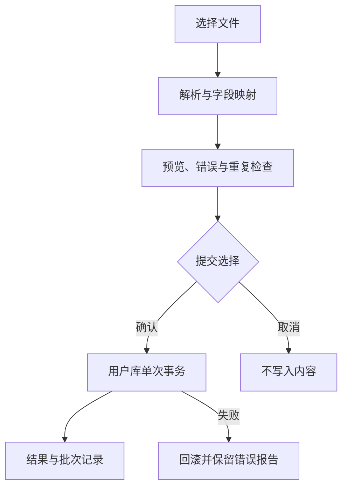

# 言间｜数据与导入规范

版本：V0.3 · 日期：2026-10-24 · 对象：Android、数据工具、测试负责人。本文是实施规格，不代表数据库、导入器或正式词库已经完成。相关范围以 [PRD](01-PRD.md) 为准，调度实现见 [技术架构](07-技术架构.md)。

## 1. 数据原则与决策来源

| 编号 | 规则 | 来源 |
| --- | --- | --- |
| DATA-01 | 文字内容、收藏和学习进度在手机本地；核心使用不依赖数据库服务器 | 用户要求 |
| DATA-02 | 首版不存影视视频或原声；来源至少能呈现原句与作品名 | 用户要求 |
| DATA-03 | 支持用户自行导入；具体格式与字段在本规格固定 | 用户要求；格式分期是实施方案 |
| DATA-04 | 官方内容与个人内容共用收藏、搜索、复习能力，但来源身份分别保留 | 实施方案 |
| DATA-05 | 官方词库更新不能覆盖收藏、复习历史、个人修改 | 实施方案 |
| DATA-06 | 正式原句不得由 AI 凭空补齐；导入声明不能升级为官方核验 | 内容准入规则 |

本地数据库采用 SQLite，以 Room 管理实体、查询与迁移。SQLite 是应用内部的存储文件，用户无需安装数据库服务。Room 支持从预置文件初始化数据库，但 `createFromAsset()` 不是每次升级时自动替换内容的更新器。[来源 1](https://developer.android.com/training/data-storage/room/prepopulate)

## 2. 当前存储与后续双库边界

当前采用 `yanjian-local.db` 单 Room 库分表：`entries` 内容、`user_entries` 用户状态、`content_manifest` 活动版本，以及 v3 新增 `activity_events` 和 `app_records`。保留 v1→v2→v3 显式迁移链、所有旧内容及用户状态。下表多物理库为后续目标；当前导入与用户域恢复均使用 Room 事务，不替换数据库文件。

| 存储 | 内容 | 写入主体 | 更新策略 |
| --- | --- | --- | --- |
| `content-<contentVersion>.db`，逻辑名 `content.db` | 官方表达、作品、原句、标签、公开来源说明 | 内容包构建工具 | 构建后应用只读；校验新版本后切换活动版本 |
| `user.db` | 个人表达、收藏、屏蔽、复习状态、复习事件、浏览记录、导入批次、个人备注 | Android 应用 | 显式迁移；禁止用删表重建解决升级问题 |
| 应用设置 | 当前模式、句子比例、标签偏好、视觉与动效偏好 | Android 应用 | 轻量键值持久化；纳入完整备份 |
| 编辑电脑候选库 | 未核验内容、证据、评分、审核过程 | 内容编辑工具 | 不随正式 App 分发 |

两库通过稳定 `entryRef` 关联，不声明跨库外键。SQLite 外键不能跨 schema 边界；应用层负责关联有效性及内容缺失处理。[来源 2](https://sqlite.org/foreignkeys.html) 正式版用户库只能由 `UserRepository` 修改；官方库不接收用户编辑。用户修改官方词的释义或备注时存覆盖层，原始官方内容仍可查看。

### 2.1 身份与版本

- 官方 ID：`official:word:<uuid>`、`official:sentence:<uuid>`；个人 ID：`personal:<uuid>`。首次创建后永久稳定；不从排序位置、文件行号或当前文本生成主键。
- `schemaVersion` 是结构版本；`contentVersion` 是词库版本；`recordVersion` 是单条修订号。三者不得互相代替。
- 同一文本的不同义项可以有不同条目；句子原文相同、来源不同也可以有多个来源关联。文本去重键只用于发现候选重复，不直接充当身份。
- 词语改错字、改释义仍保留 ID；实际变成另一个词或义项则新增 ID，旧条目标记替代关系。必须由编辑明确迁移，禁止自动迁移学习状态。
- 官方条目撤下后停止推荐；个人收藏仍保留 ID、学习记录和当时的最小内容快照，并标记“原内容已更新或移出词库”。涉及必须删除文本的内容更正另有删除策略，不能静默删除学习事件。

## 3. 逻辑数据模型

下面定义字段语义；实现时使用 Room 实体和迁移文件生成实际 schema。`*_at`、`due_at` 均为 UTC 毫秒时间戳，缺失使用 `null`，禁止用 `0` 冒充“未知”。

### 3.1 官方内容库

| 表 | 关键字段 | 约束与用途 |
| --- | --- | --- |
| `content_manifest` | `dataset_id, schema_version, content_version, built_at, minimum_app_version` | 单一活动内容版本；生成时间不充当发布时间 |
| `entry` | `entry_id, kind, text, search_key, short_meaning, main_category, record_version, published_at` | `kind=word/sentence`；短释义不能混入长篇背景；只有已发布记录进入正式包 |
| `entry_detail` | `entry_id, usage_note, situation, tone, common_mistake` | 卡片详情使用；字段允许缺失，不拼出空标题 |
| `tag` / `entry_tag` | `tag_id, label` / `entry_id, tag_id` | 多标签；主分类只有一个，防止 6:4 统计双计 |
| `work` | `work_id, title, work_type, original_language, release_year, edition` | 作品同名不自动合并；年份未知可空 |
| `quote` | `quote_id, work_id, exact_text, speaker, episode, timestamp_ms, subtitle_version, translation_credit, source_url` | 原句原样保存；时间码没有证据就空；字幕版本独立记录 |
| `entry_quote` | `entry_id, quote_id, match_start, match_end, evidence_status` | 一个词多个原句，一个原句多个词；高亮位置按选定文本索引协议统一 |
| `entry_relation` | `from_id, to_id, relation, note` | 近义、反义、易混或替代；近义不等于可互相替换 |
| `attribution` | `attribution_id, owner, source_url, license_name, license_url, change_note` | 对应实际采用内容，供来源页与离线署名使用 |

发布包只携带用户需要的来源与署名信息。编辑的内部审核笔记、未发布候选、人员私人联系方式不打入 App。`evidence_status=verified` 仅说明原文对应关系经过核验，不能替代许可与发布审批。

### 3.2 用户库

| 表 | 关键字段 | 约束与用途 |
| --- | --- | --- |
| `personal_entry` | `entry_id, kind, text, short_meaning, category, tags_json, created_at, updated_at` | 用户导入或自行录入；不得伪装官方 ID |
| `personal_source` | `source_id, entry_id, title, quote, source_url, subtitle_version, user_note` | 统一为个人提供，官方核验位不能由文件传入 |
| `entry_snapshot` | `entry_ref, record_version, kind, text, short_meaning, source_summary` | 收藏时保存最小可读快照，支持旧内容缺失和备份恢复 |
| `collection` | `entry_ref, collected_at, archived_at` | `entry_ref` 唯一；重复收藏不增加计数；取消收藏保留历史 |
| `visibility_override` | `entry_ref, hidden_at, reason` | 屏蔽影响发现推荐，不删除已收藏内容；可撤销 |
| `personal_note` | `entry_ref, note, meaning_override, updated_at` | 官方内容个人覆盖，不回写 `content.db` |
| `review_card` | `entry_ref, scheduler_state, mastery_level, due_at, last_review_at, scheduler_version, parameters_id, state_json` | 一条表达一张卡；版本化调度状态 |
| `review_event` | `event_id, entry_ref, session_id, presentation_id, graded_at, local_date, zone_id, ui_grade, algorithm_grade, previous_state, next_state, undone_at` | 提交幂等；完整回放；撤销保留事件而非静默改写日志 |
| `browse_event` | `event_id, entry_ref, occurred_at, local_date, zone_id, mode, event_type` | 只记实际曝光和打开；预加载不记“看过” |
| `import_batch` / `import_item` | `batch_id, file_hash, format, status, summary` / `batch_id, source_key, entry_ref, action` | 批次核对、重复导入防护、错误报告 |
| `content_activation` | `content_version, activation_state, activated_at` | 安装恢复日志；不能在切换成功前宣告激活 |

逻辑未学习状态映射为实际 `mastery=NEW`，等价于原规格的 `mastery_level=null`，不是第四个评分等级。v2→v3 将 `reviewCount=0` 的旧关系改为 NEW；只有当前收藏纳入初学和掌握分布，单独屏蔽不计。已评分原等级及次数保留，收藏时间缺失留 null 并排在已知时间后；旧 lastReviewedAt 非空时按 1/3/7 天回填 dueAt，缺日期不伪造。所有状态标明 `schedulerVersion=demo-1`。缺释义的个人收藏为待补充，补齐后进入初学；官方句子允许用真实来源揭晓。

复习等级、算法内部阶段和是否到期是三个不同维度：“已会”仍可能到期，`scheduler_state=review` 不代表用户自评“已会”。统计不从三个标签反推记忆概率。

## 3.3 本轮官方文本包契约（数据与 App 的权威接口）

唯一生产输入为 `data/processed/official-content.json`；Gradle 自动复制到生成目录的 `assets/content/official-content.json`，禁止手工维护另一份。候选文件留在 data，不打包。工程测试 fixture 只在测试目录，不作为正式数据。若生产文件缺失，开发构建仍可生成，但 App 明示内容包未就绪，不播种演示数据。

包字段：`format="yanjian-official-content"`、`schemaVersion=1`、`datasetId="yanjian-text"`、整数 `contentVersion>=1`、非空 `entries` 数组。条目字段：稳定 `id=official:word:<uuid>` 或 `official:sentence:<uuid>`，`recordVersion>=1`，`kind=word/sentence`，非空 `text`，`shortMeaning`（word 必须非空中文；sentence 可空字符串），`genre=practical/classic`，`category`，字符串数组 `tags`，可空 `usageNote`，`publicationStatus="published"`，非空 `sources` 数组。`genre` 保留既有实用/经典 60:40 含义；`category` 是领域，二者不得混用。

领域枚举（对接生产报告扩充，不把领域混作 genre）：`日常交流、古典诗词、时间与安排、学习与工作、家庭与朋友、情感与心情、请求与建议、出行与地点、饮食与生活、健康与身体、问候与礼貌、天气与环境、写景状物、购物与金钱、评价、人际、送别思乡、表达、情感、行动、思维、抒情言志、人生感怀、生活、时间、咏史怀古、自然、学习、边塞征战、状态、态度、工作、品格、批评、方法、行为、比喻、性格、经历、道理、祝愿、日常实用、经典表达、情感表达、人生感悟、期待、情绪、沟通、安慰、拒绝、告别、思念、鼓励、克制`。保留旧 UI 领域可选性。标签 `daily` 表示日常，`writing` 表示写作；可同时具备，也可附其他标签。App 的日常/写作选择是标签过滤，不新增比例。领域多选为并集；领域全不选表示无结果，不静默当作全选。用途全不选也表示无结果。usageNote 可为 null 或空字符串；来源未知字段为 null。

每个 source 必须包含 `id,type,title,quote,locator,url,edition,licenseName,licenseUrl,attribution,evidenceStatus,rightsStatus`。未知可空字段严格为 JSON null；`id` 非空且同条目内唯一。type 枚举：`dictionary`（词典）、`community_sentence`（社区例句）、`public_domain_text`（公共领域文本）、`original`（自制原创）、`film`（影视）。`evidenceStatus=source_checked/verified`：前者表示来源记录已检查，后者仅用于原文、版本、位置真实核验，不能由 AI 或按钮推定。`rightsStatus=open_license/public_domain/original`；原创必须明确署名自制，且 type=original 与 rightsStatus=original 配对。开放许可必须有真实许可名称、许可链接和署名。非原创必须有 url 或 locator 供追溯，title 未知可 null；主正文至少有一条匹配 quote，或来源 locator 明确定位到该正文，不能只挂无关出处。App 校验结构与声明，不能自动证明来源事实，数据侧仍承担真实核验。

只给一条契约例子（本项目自制教学句，不是生产数据量证明）：

```json
{"format":"yanjian-official-content","schemaVersion":1,"datasetId":"yanjian-text","contentVersion":1,"entries":[{"id":"official:sentence:43e34121-22ca-49bf-b1de-f647e8452642","recordVersion":1,"kind":"sentence","text":"我想把这句话好好说完。","shortMeaning":"","genre":"practical","category":"沟通","tags":["daily","writing"],"usageNote":null,"publicationStatus":"published","sources":[{"id":"original-001","type":"original","title":"言间自制教学句","quote":"我想把这句话好好说完。","locator":null,"url":null,"edition":null,"licenseName":null,"licenseUrl":null,"attribution":"言间项目自制原创","evidenceStatus":"source_checked","rightsStatus":"original"}]}]}
```

后台流式解析，每次只保留一个条目的文本及 ID 去重集合；整包在一次 Room 事务中处理。损坏、重复 ID、非法状态、记录降版或同修订号内容冲突均回滚，活动指针仅成功后更新。相同包版本重复导入只校验、不覆盖；低包版本拒绝。增量更新依据稳定 ID 和递增 recordVersion，绝不改 `user_entries`。本包未包含的旧官方条目及旧演示记录保留可读，但不进活动推荐。句子缺释义时翻面显示已有 usageNote 或真实来源，不能生成占位释义。旧样例如实标为 original。

## 4. 内容导入协议 v1

### 4.1 格式与边界

| 格式 | 首版范围 | 处理 |
| --- | --- | --- |
| JSON | 必做 | 完整内容字段、版本、显式词句类型，作为无损内容交换首选 |
| CSV | 必做 | 有表头；支持引号、逗号、引号内换行及 UTF-8 BOM |
| TXT | 必做 | 每行一条；全文件选择默认类型，也可逐行修正；不猜影视来源 |
| TSV | 后续；首版可选扩展 | 与 CSV 共用字段映射，以制表符分隔；未经实现与验收不宣称支持 |
| XLSX、Markdown、SRT | 后续 | 首版明确提示不支持，不能改扩展名后冒充 CSV |

个人导入无须满足官方影视来源门槛。缺释义可以导入并标为“待补充”，可浏览、收藏和编辑；首轮不加入遮答复习，补齐释义后才纳入待初学队列，不调用在线 AI 自动补写。对 JSON/CSV 的显式 `kind` 优先采用；对没有类型的 TXT，界面可以提出分类建议，但提交前允许用户修正，不能仅凭二字、四字判断所有条目。

### 4.2 JSON 示例

以下为本项目原创的个人内容样例，不是影视台词。该文件只交换内容，不带收藏时间、评分或复习进度。

```json
{
  "format": "yanjian-content",
  "schemaVersion": 1,
  "packageId": "personal-example-001",
  "title": "我的表达",
  "entries": [
    {
      "externalId": "my-word-001",
      "kind": "word",
      "text": "斟酌",
      "shortMeaning": "多想一想，让说法更妥当。",
      "category": "沟通",
      "tags": ["措辞", "考虑"],
      "source": null
    },
    {
      "externalId": "my-sentence-001",
      "kind": "sentence",
      "text": "我想把话说清楚，也想给你一点时间。",
      "shortMeaning": "同时表达沟通意愿与对方的空间。",
      "category": "practical",
      "tags": ["沟通", "边界"],
      "source": {
        "kind": "personal",
        "title": "个人随记",
        "quote": null,
        "url": null,
        "subtitleVersion": null
      }
    }
  ]
}
```

| 字段 | 规则 |
| --- | --- |
| `format` / `schemaVersion` | 必须匹配已支持协议；高版本不能按 v1 静默吞字段 |
| `packageId` | 可选；用于同一来源文件的稳定更新识别，不赋予官方身份 |
| `externalId` | 可选；在同一 `packageId` 内唯一；不能直接成为官方主键 |
| `kind` | `word` 或 `sentence`；未知值进入错误行 |
| `text` | 必填；首尾空白可用于展示前修整，原始输入另存解析结果；不能是纯空白 |
| `shortMeaning` | 可选字符串；建议编辑为一两句，导入不自动截断 |
| `category` | 句子为 `practical/classic` 或待用户映射；词语可以是领域分类 |
| `tags` | 可选字符串数组；去除空项、重复标签；保留用户自定义标签 |
| `source` | 可空；只表示个人提供的出处；禁止接受 `verified=true` 来升级信任 |

### 4.3 CSV 与 TXT

CSV 推荐表头：`kind,text,shortMeaning,category,tags,sourceTitle,sourceQuote,sourceUrl,externalId`。`tags` 内部使用 `|` 分隔；不把全角逗号当列分隔。兼容中文表头“类型、内容、释义、类别、标签、作品名、原句、来源链接、外部编号”，首次识别后展示字段映射。缺少“内容”映射必须阻止提交。

TXT 支持 UTF-8 与 UTF-8 BOM；空行忽略。一行是一条，换行不能同时被解释为条目内部换行。多行句子使用 JSON 或带引号 CSV。遇到非 UTF-8 文件先提示选择已支持编码或另存为 UTF-8，不通过丢弃非法字节“修复”。首版是否增加 GB18030 由解析器实现与测试决定，不能提前宣称支持。

## 5. 导入状态机与去重



1. Android 通过系统文件选择器读取用户选定文件；不申请全盘读取权限。Storage Access Framework 支持用户选择特定文档及创建导出文件。[来源 3](https://developer.android.com/training/data-storage/shared/documents-files)
2. 在后台解析，初始工程限制为单文件 10 MiB、10,000 条、单条正文 4,000 个 Unicode 码点、最多 20 个标签。限制是待性能实测的保护阈值，不是词库总容量限制。超限提示具体位置，可拆分后重新导入。
3. 预览展示有效、缺释义、疑似重复、错误的数量和具体行号。错误行默认不导入；点击确认前明确说明将导入几条、跳过几条。
4. 所有最终选中的条目、收藏勾选与批次结果在一个用户库事务提交。磁盘不足、强退、取消造成的失败不得留下半批收藏或悬空复习卡。
5. 成功后给出可查看的批次结果。默认加入“我的内容”；“同时收藏并加入待初学”是可见选项；缺释义条目只收藏并留在待补充。导入不自动评分，不篡改原有学习计划。

### 5.1 三层重复判断

| 情况 | 默认行为 | 用户可选 |
| --- | --- | --- |
| 同一文件哈希重复、已有完成批次 | 提示已导入，预览差异为零 | 重新检查；不能无提示再复制一份 |
| 同 `packageId + externalId`、内容未变 | 跳过 | 无需重复创建 |
| 同 `packageId + externalId`、内容变更 | 展示字段差异 | 更新个人内容或保留原条；学习记录不重置 |
| 同正文、同义项或同句但身份不同 | 标记疑似重复 | 跳过、补充来源、保留两条 |
| 同正文但不同释义、字幕版本 | 不自动合并 | 人工选择关联来源或独立保留 |

搜索与去重可以使用 NFC、首尾空白移除、统一换行等保守规范化；原文、标点、繁简和字幕译法保持原样。繁简转换、删除所有标点、近义替换不能作为自动覆盖依据。更新只补充明确选择的字段，禁止空值覆盖现有释义。普通文件中的 ID、评分、官方核验标志和 SQL 均不直接执行或信任。

## 6. 导出、备份与恢复

**内容导出**产生 `yanjian-content` JSON 或 CSV，包含个人表达及选择导出的内容字段，便于编辑和共享；它不能完整迁移学习进度。**完整备份**使用独立 `yanjian-backup` 格式，包含 schema 版本、个人内容、内容快照、收藏、屏蔽、复习卡、事件、偏好、导入来源映射及所用官方内容版本。

完整备份默认不复制整个官方词库；恢复时先匹配稳定官方 ID，没有对应版本则使用收藏快照显示，避免丢失收藏或错误匹配同名内容。首版恢复采用“替换当前用户数据”，恢复前先生成当前数据的本地恢复点并展示影响摘要。多设备学习日志合并不在首版范围；禁止简单用“最新时间覆盖”合并两套复习状态。

完整备份通过 Room 事务读取一致逻辑快照，再后台序列化为 `format=yanjian-backup,schemaVersion=1,payload,sha256`；payload 为包含 databaseVersion=3、官方内容版本、个人内容、关联官方快照、用户关系、事件、会话/界面/导入记录及偏好的 JSON 字符串，摘要对该字符串 UTF-8 计算。首版读取上限 64 MiB。恢复先完整验证，再在同一个 Room 事务内写入恢复点并替换用户域；当前官方内容保留，缺失官方 ID 用退役快照补齐而不进推荐。偏好以事务内持久化交接记录应用，进程中断后可继续；成功后删除交接记录。不复制活跃裸 DB，不切换文件；失败不宣告恢复成功。系统创建文档输出的是完整预先生成的逻辑备份，写入失败提示用户重新导出。

CSV 面向表格软件时对以 `= + - @` 等开头的单元格使用安全文本导出策略，并在导出说明中标明；JSON 保存原文。内容仅按纯文本显示，不执行 HTML、脚本或公式。日志不输出完整个人笔记；解析错误报告只保留必要字段与行号。

## 7. 官方内容更新与时间口径

当前 JSON 安装包更新采用 3.3 节的单库事务和活动版本，不替换文件，失败回滚；下面的签名包和多物理库切换仍是后续远程/手动包目标。内容包先写入应用私有临时目录，校验 manifest、schema、条目与关联数量、完整性及摘要；公开分发的外部“官方包”还须验证签名，单有 SHA-256 不能证明发布者。用户提供的未经签名内容走个人导入路径，不得执行文件中的迁移 SQL。

事件保存 UTC 时间以及事件发生时的 `zone_id`、`local_date`。今日、七日、三十日统计按用户当时所在时区的本地日分组，跨时区不重新改写历史日期；到期判断使用真实时间戳。修改系统时间导致负间隔时记录异常、等待合理时间，不能让调度计算负天数。首次收藏、浏览、评分分别统计；返回旧卡片不重复计为新内容，快速连点评分用 `presentation_id` 去重。

### 当前 v3 的实现映射

`user_entries` 增加 collectedAt、dueAt、schedulerVersion、revision；`activity_events` 的唯一 eventId 同时作为评分 presentationId，保留 UTC 时间、zoneId、localDate、sessionId、前后用户快照和 undoneAt。评分与会话推进同事务，撤销本会话最近有效评分并检查后状态及 revision，冲突不覆盖。`app_records` 按 type 保存会话、模式/发现草稿、导入键与批次、恢复点；备份恢复按类型检查结构和引用。收藏与屏蔽修改只改变关系字段及修订，不重置学习字段。首版简化调度为不熟悉 1 天、熟悉 3 天、已会 7 天，非 FSRS。

## 8. 数据验收底线

| 验收编号 | 输入/动作 | 必须结果 |
| --- | --- | --- |
| DATA-AC01 | 关闭网络后浏览、收藏、重启、复习 | 数据存在且流程可用 |
| DATA-AC02 | 官方包升级与回退 | 个人内容、收藏、事件 ID 不变 |
| DATA-AC03 | 导入同一 JSON 两次 | 第二次不增加重复记录或复习卡 |
| DATA-AC04 | CSV 含逗号、双引号、换行、中文 BOM | 正文与列位置正确，无隐式截断 |
| DATA-AC05 | JSON伪造官方ID、`verified` 或SQL字段 | 不获得官方身份，不执行文本 |
| DATA-AC06 | 导入一半时失败 | 用户库保持提交前状态 |
| DATA-AC07 | 首次收藏但未评分 | 待初学+1；三个掌握等级不被虚增 |
| DATA-AC08 | 导出后在空用户库恢复 | 条目、收藏、状态、事件、偏好逐项相符 |
| DATA-AC09 | 新 schema 无迁移路径 | 保护原库并给出错误，不破坏性重建 |
| DATA-AC10 | 同词不同义、同句不同字幕版本 | 不自动覆盖；用户可看见差异 |

## 9. 参考依据

核验日期：2026-10-24。资料只支持相关平台能力，本文字段、阈值与流程是本项目设计决定。

1. [Android：预置 Room 数据库](https://developer.android.com/training/data-storage/room/prepopulate)。
2. [SQLite：外键支持与跨 schema 限制](https://sqlite.org/foreignkeys.html)。
3. [Android：通过系统文档选择器访问与创建文件](https://developer.android.com/training/data-storage/shared/documents-files)。
4. [Android：Room 迁移与破坏性迁移风险](https://developer.android.com/training/data-storage/room/migrating-db-versions)。
