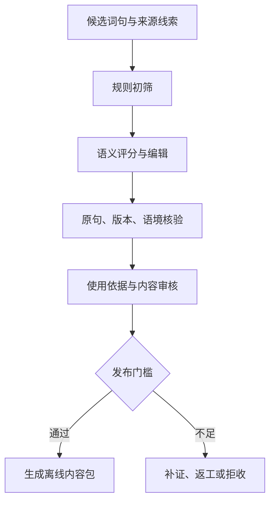

# 言间｜内容生产与核验

版本：V0.3 · 日期：2026-10-24 · 对象：产品、内容编辑、审核、数据工程。本文定义正式词库的生产流程；文中数量均为建设目标，不能作为已经拥有的合格数据数量。数据结构见 [数据与导入规范](05-数据与导入规范.md)。

## 1. 内容定位

最新用户决定：来源不限影视或书籍，覆盖日常聊天、情感表达与写作；可采用词典、社区例句、公共领域文本、自制原创、影视。来源必须真实可追溯、发布依据明确；不能为了影视体验编造出处。首版只展示文字与来源信息，不提供影视画面、原声或剪辑。

用户已经确认句子推荐默认为实用表达 60%、经典/哲理/审美表达 40%，并允许用户调整类别及比例。这是推荐策略，不要求数据库永久保持精确的 6:4 数量。正式内容需要足够的各类候选来支持选择；某类不足时诚实提示或按已选范围循环，不能偷偷用其他类别填充。

### 1.1 三种身份必须区分

| 身份 | 用途 | 出处要求 | 能否进入正式推荐池 |
| --- | --- | --- | --- |
| 官方精选 | 默认学习内容 | 至少一条经核验、允许发布的引用或来源记录 | 审核发布后可以 |
| 用户个人 | 用户收藏、导入、个人练习 | 可没有来源；保留用户提供信息 | 默认留在个人内容，是否参与发现由用户显式选择 |
| 设计演示 | 验证布局、动效与流程 | 使用原创示例或明确标明未核验 | 不随正式词库发布 |

设计稿、生成图、早期 HTML 或测试 APK 中出现一个词或作品名，不代表完成内容核验。视觉演示禁止加虚假核验徽章。自制原创可以按真实原创身份进入正式包，设计演示 fixture 不能假装生产数据；数量由真实可发布数据决定。

## 2. 数据来源与使用方式

现有词典、例句和语录资源可以缩小候选范围，但不能直接等同于满足言间标准的影视学习词库。以下为本轮实际查阅的一手来源，核验日期为 2026-10-24；本项目尚未完整下载、清洗或引入这些数据。

| 来源 | 已核验事实 | 本项目的适用方式 | 不能直接推导的结论 |
| --- | --- | --- | --- |
| [chinese-xinhua](https://github.com/pwxcoo/chinese-xinhua) | 仓库提供字、词、成语等数据并展示 MIT 许可证 | 研究词形、候选集合与数据质量 | 仓库许可不能自动证明每段第三方释义、例句均获得完整再发布权 |
| [CC-CEDICT](https://cc-cedict.org/wiki/) | 官网说明采用 CC BY-SA 4.0；是可下载的汉英词典 | 辅助词形、读音与词义检索；采用内容时保存署名与修改信息 | 它不是影视台词库，也不是天然适合本项目的中文短释义库 |
| [Tatoeba 下载](https://tatoeba.org/en/downloads) | 下载说明标注 CC BY 2.0 FR，部分句子另有 CC0 1.0 | 参考自然例句及标签；按实际记录许可处理 | 不能把社区例句附上电影名当影视原句；不能一概称所有数据 CC0 |
| 作品发行方、制作方、合法发行版本的字幕或剧本 | 具体条目需逐份记录版本、位置与使用依据 | 优先核对台词、人物、上下文与译文版本 | 来源能核验不等于任何规模、方式的再发布都自动获准 |
| 语录站、搜索结果、用户投稿 | 可作为发现线索 | 找到线索后回到更可靠的原始材料核验 | 二次转载、搜索摘要、模型回答不能单独充当完成核验的证据 |

CC BY-SA 4.0 的官方说明要求适当署名、许可链接、修改说明，并对改编适用相同许可要求；同时提示许可未必涵盖预期用途所需的全部权利。实际采用前将对应的内容、许可与分发方式登记，不把软件许可证和作品引用许可混为一项。[许可依据](https://creativecommons.org/licenses/by-sa/4.0/)

用户已授权建设大量纯文字内容，数量不设影视来源前提。独立 `data/` 由数据负责人维护候选、来源与构建脚本；只有按 05 契约发布的 `data/processed/official-content.json` 进入 App 生成 assets，候选不可直接打包。App 工程负责人不手工双份维护大数据。

## 3. 生产流程与状态



流程允许并行编辑与查证，发布门槛保持一致。记录状态采用 `candidate → editing → evidence_pending → review_ready → approved → published`；也允许 `rejected`、`withdrawn`。文本修改、替换字幕版本或修改作品名，会使原核验失效并回到待核验；仅修正不影响原文的标签不必重做全部来源核验，但仍记录修订。

准入条件同时满足：表达价值合格、至少一条可追溯来源、引用与版本匹配、必要发布依据已记录、展示字段完整、重复与错别字检查通过。高 AI 评分不能抵消来源或发布依据缺失。

### 3.1 规则初筛

词语模式主要保留两字词与四字表达；罕见专名、纯技术术语、地域限制很强或缺乏现实迁移价值的候选，默认降低优先级。四字不自动等于成语；不为了统一格式错误标注词性。句子按完整意思与可引用长度筛选，不能剪掉否定词或关键前提来制造“金句”。

规则程序做空白检查、文本格式检查、候选去重、长度统计、标签规范和字段完整性；近义词只聚类，不自动全部删除。例如意义相近但语体、情绪强度、关系距离不同的词，应保留并解释差别。没有价值区别的高度重复表达再由编辑合并。

### 3.2 AI 的职责

AI 在电脑端批量处理，承担候选筛选、语体判断、短释义初稿、使用场景、易混辨析、标签与近义聚类。输出进入待审核区，不直接发布。App 运行不依赖 AI 服务，不在客户端放 API 密钥。

AI 只能引用给定证据。输入没有作品或原句时必须返回 `null`，不得凭模型记忆补电影名、人物、集数或时间码。模型评分及理由保存为内部建议，并记录模型标识、提示词版本、输入摘要、生成时间；这些不是用户可见的“准确率”。

建议评分字段均为 0–5：`practicality` 日常可用性、`naturalness` 说出口是否自然、`emotionValue` 情感表达价值、`distinctiveness` 相对普通表达的增益、`explanationClarity` 可解释性。词语与实用句建议以自然、实用为重点；经典句允许实用度较低，但仍要求语义完整并明确属于欣赏/写作语境。综合分只排序，不作为准入许可证。

```json
{
  "candidateId": "candidate-demo-001",
  "text": "斟酌",
  "scores": {
    "practicality": 4,
    "naturalness": 4,
    "emotionValue": 2,
    "distinctiveness": 3,
    "explanationClarity": 5
  },
  "suggestedMeaning": "多想一想，让说法更妥当。",
  "suggestedTags": ["措辞", "考虑"],
  "sourceQuote": null,
  "sourceWork": null,
  "evidenceStatus": "missing",
  "publishable": false
}
```

以上是流程示例，分数不是经过实验测得的客观指标；该条也没有获得影视收录资格。

## 4. 原句核验清单

| 项目 | 必须记录 | 不足时的处理 |
| --- | --- | --- |
| 作品身份 | 作品名、类型、可确定的版本/年份，剧集含集数 | 同名作品无法区分则待核验 |
| 原句 | 按核验版本保存完整文字，标明是否节选 | 原句对不上则不发布；不得改写后仍叫原句 |
| 位置 | 能确定的时间码、页码、章节或资料链接 | 无法确认时间码可留空，不能估算填入 |
| 人物与上下文 | 说话者、面对谁、发生了什么、情绪和关系 | 不了解则仅显示已核实内容，不编故事 |
| 词语命中 | 原句是否真的含目标词，义项是否一致 | 只出现近义词不能作为该词的出现证据 |
| 外语字幕 | 原始语言、译文版本或字幕来源、译者信息如可获得 | 不同字幕不可混引；中文改写另存编辑释义 |
| 核验过程 | 证据定位、核验人、核验时间、对应记录版本 | 无记录不标已核验 |
| 发布依据 | 使用许可、可适用的引用依据或明确授权记录 | 留在候选；不能用“网上能搜到”代替 |

词源、字典解释、影视出现记录分别建字段。“这个成语源自古籍”和“这部电影中使用过这个词”是不同事实。一个词允许挂多个影视例句，以更自然、易懂、可迁移的例句为默认展示；多个来源不增加同一个词的学习计数。

编辑侧可以保留 missing/located/disputed/unresolved 等工作状态；正式输出严格只允许 `evidenceStatus=source_checked/verified` 和 `rightsStatus=open_license/public_domain/original`，语义与必填字段见 05 的官方文本包契约。source_checked 不是原文严格核验，verified 必须有真实核验依据；两者均不能替代许可。原创明确自制，未知字段 null，词典/公共领域/影视来源不互相冒充。

## 5. 编辑标准

### 5.1 卡片短释义

词语与句子的释义必须为清楚的中文。翻面只显示真实短释义；未编写时明确提示待补充，不再用usageNote或来源替代。缺释义可保留阅读收藏，但不评分。编辑目标12–40字是建议，硬限6–60字，不为字数牺牲准确；出处和许可放折叠区。contentVersion=5 全部29,635条官方句子有释义：DeepSeek补齐原缺失29,552条，主代理随机分层抽查50条（实用35、古典15），13处问题交回修正。收尾发现classic-a末4片仍有繁简/词序替换，DeepSeek另重写184条；主代理从中随机抽查35条，将14处具体误解交回修正并读回。保留否定、条件、人物关系、数量、时态与语气；古典句须解释成现代白话，不能仅换繁简或词序，不添原句没有的背景、感悟。释义按data/editorial/sentences.psv接入，后续修订号在sentence-gloss-revisions.psv登记；原句仅按有据校改表定点修正，ID保持。上述抽查不等于全库逐条人工审校。

### 5.2 使用指导

词语记录语体（口语/书面/均可）、情绪色彩、程度、适用关系和常见误用。句子记录表达目的（安慰、拒绝、思念、感谢、遗憾、赞美、释怀、鼓励、告别等），并标记哪些字句需要按生活情境调整。编辑创作的改写或生活例句必须标为“用法示例”，不能与影视原句混排成一段出处不明的引文。

“能主动运用”靠理解语境和自我回忆支持，不能仅凭收藏或点“已会”保证达成。对于经典哲理句，不强行称其日常高频。需要特殊身份、强冲突或特定剧情才能自然说出的句子，给出使用限制或降低日常推荐权重。

### 5.3 近义与重复

重复分为词形重复、义项重复、表达效果重复、原句版本重复。只有明确相同身份的重复可以自动合并；其他情况进入人工判断。合并官方条目保留旧 ID 的替代映射，并与技术负责人确认学习记录迁移方案；不直接删除已发布 ID。近义组内保留表达差异说明，避免用户连续刷到几张几乎相同的卡片。

## 6. 推荐池与内容覆盖

句子 genre 固定 `practical/classic`，保留默认 60:40 推荐含义；领域 category 使用 05 的枚举。用途由 daily/writing 标签表示，允许二者同时存在；不新增用途比例。主类、领域、标签不混用。所需类型空池明确提示，不静默换类；App 只加载有界推荐队列。

中文优先作为来源排序偏好，不把非中文作品一律排除。没有用户明确比例前，不擅自固定“外语只能占 10%”之类配额。中文优先不能替代质量门槛；不好的中文候选不因语言优势获得发布资格。

内容编辑每批检查覆盖矩阵：词长、语体、表达目的、情绪强度、来源作品、作品类型、年代范围、中文/字幕版本。主页面依旧极简，覆盖矩阵属于编辑工具，不塞进用户首页。

## 7. 本地内容管理工具

内容工具运行在编辑电脑，与 Android App 分开。本轮发布形态是 05 规定的版本化 JSON，工程构建自动复制到生成 assets，App 后台流式验证后事务导入 Room；独立多物理库/SQLite 文件发布为后续方案。无需部署在线数据库、账号系统或在线审核服务。

| 页面/能力 | 最小功能 | 数据结果 |
| --- | --- | --- |
| 候选列表 | 按类型、标签、状态、缺失证据筛选 | 不影响正式推荐池 |
| 编辑页 | 正文、短释义、详解、主分类与标签 | 保存修订版本 |
| 来源页 | 作品、原句、位置、字幕版本、证据、发布依据 | 独立记录核验与使用条件 |
| 审核页 | 前后差异、问题、通过或退回 | 审核日志；同人兼任也保留角色记录 |
| 包预览 | 条数、类别覆盖、缺失字段、重复与引用完整性 | 阻断错误发布 |
| 导出 | 版本号、manifest、署名、校验摘要 | 可回滚的内容包与报告 |

初期单人可兼任编辑和审核，不因此省略出处字段。正式扩大生产时再安排复核；不在第一版建设多用户 Web 后台或权限平台。工具的“预览演示”“标记核验”“实际发布”必须明确区分。

## 8. 首轮数据实验与交付

先完成 30–50 条覆盖不同场景的高质量样本，检查卡片阅读与影视来源的实际取得难度；再扩展批量筛选。此前提出的“500 个两字词、500 个四字表达、200 条句子”是候选实验规模，不是承诺的首发合格数量。首批内测目标可参考 300–500 词、100–200 句；首发扩充目标 1,000–1,500 词、300–500 句，最终以审核通过与学习体验为准。

每一批报告记录：候选总数、规则通过数、语义编辑通过数、来源核验通过数、可发布数、返工原因、平均核验耗时、词句与类别分布。发布率定义为“最终可发布数/本批候选数”；不能把已评分或查到作品名的条数算为发布数。

人工质量校准先抽取不少于 30 个不同来源的候选作对照，比较 AI 建议与编辑判断；这只是工程试验的初始规模，不是统计显著性承诺。分歧优先修正评分说明、提示词和样例，不能仅提高阈值掩盖错误来源。

每个正式内容包交付：稳定 ID 的结构化内容、来源/署名清单、版本及变更说明、核验报告、自动校验结果、撤回/替代映射。未经处理的完整影视字幕不作为常规 App 附件。

## 9. 发布验收

| 编号 | 门槛 |
| --- | --- |
| CONTENT-AC01 | 正式包所有条目都有可发布来源关联；个人/演示条目无法混入 |
| CONTENT-AC02 | 所有标为影视原句的文本能对应具体核验记录与版本 |
| CONTENT-AC03 | 抽查不存在把释义、改写或字幕另一版本当原句的情况 |
| CONTENT-AC04 | 词语真的出现在关联原句中，义项一致；节选没有改变原意 |
| CONTENT-AC05 | 经典与实用分类互斥；主分类不因多标签而重复计数 |
| CONTENT-AC06 | 缺时间码、年份、人物时保持空值，不展示编造信息 |
| CONTENT-AC07 | 发布包通过结构、引用、重复、署名与版本校验 |
| CONTENT-AC08 | AI 评分、按钮模拟和演示数据没有被描述为事实核验 |

## 10. 参考来源与范围

核验日期：2026-10-24。这里列出的是数据发现与平台/许可一手资料，不表示对任何尚未核验的具体影视引文作过确认。

- [chinese-xinhua 仓库](https://github.com/pwxcoo/chinese-xinhua)。
- [CC-CEDICT 官网与许可说明](https://cc-cedict.org/wiki/)。
- [Tatoeba 下载与数据许可说明](https://tatoeba.org/en/downloads)。
- [Creative Commons BY-SA 4.0 官方说明](https://creativecommons.org/licenses/by-sa/4.0/)。
