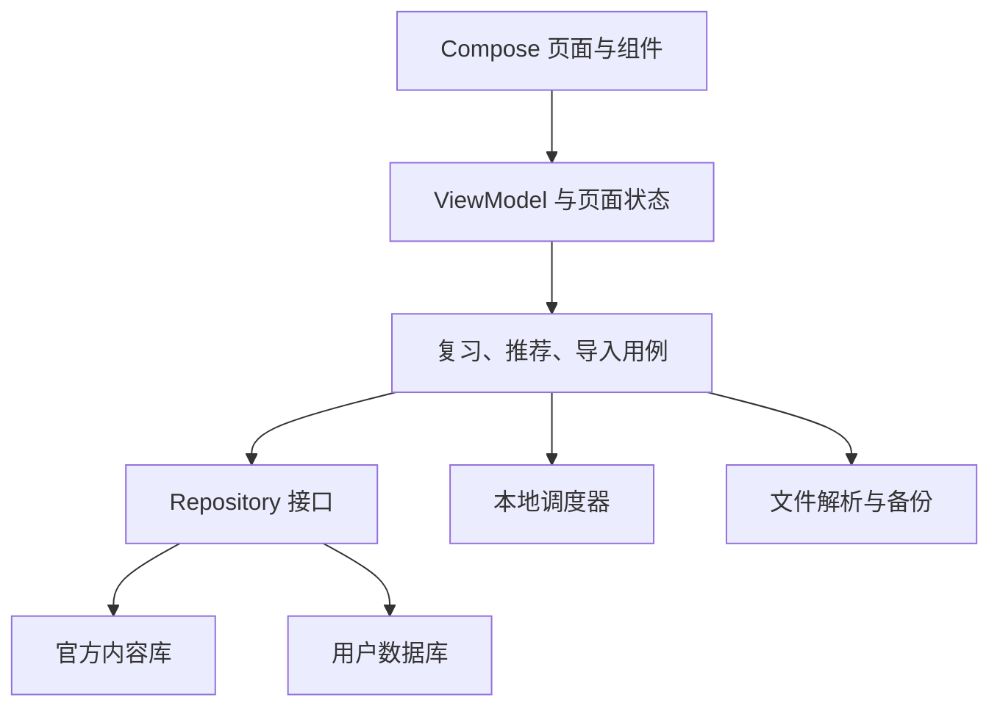

# 言间｜技术架构

版本：V0.3 · 日期：2026-10-24 · 对象：Android、前端原型、数据工具、测试负责人。本文给出实施方向；实际依赖版本、编译结果与已完成功能以构建文件和交付记录为准，不把设计稿等同于可安装 Android 应用。

## 1. 技术边界

产品目标是 Android 原生离线文字学习应用。首版核心流程为发现、详情、收藏、复习、统计、偏好、个人导入与备份；不需要数据库服务器、强制登录、在线 AI 或影视音视频服务。内容生产在电脑端进行，正式内容打包到 App 或通过后续手动内容包更新。

**本轮实现边界：**先制作可编译的 Compose 离线演示骨架，使用 Room 用户库保存个人状态，使用原创示例 JSON 作为内容资产。正式的版本化 `content.db`、完整内容审核工具、完整导入备份与 FSRS 适配按后续里程碑实施。本文件描述目标架构，不能据此声称这些目标已全部完成；实际完成项、命令退出码与 APK 情况记录在交付文档。

已读根目录 `AGENTS.md` 与 [本机 App 开发环境](../本机App开发环境.md)。环境清单记录两套 SDK；主线程本轮实际验证 JDK 17.0.19、Gradle 8.13 可执行，主构建 SDK 为 `D:/AI-USE/path/android-sdk`，模拟器组件位于 `D:/AI-USE/AndroidEmulator/Sdk`。AGP 8.13.2 仅为已发现缓存候选；最终编译 SDK、AGP、Kotlin 与 Compose 版本以构建锁定文件及真实编译验证为准，不移动或合并两套 SDK。

| 层面 | 实施方案 | 边界 |
| --- | --- | --- |
| Android UI | Kotlin + Jetpack Compose | 双模式主题、卡片、详情面板、导航与系统返回 |
| 状态管理 | ViewModel + 单向数据流；协程/Flow | UI 从状态绘制，不直接执行数据库写入 |
| 本地数据 | Room + SQLite 双库 | 官方库应用层只读；用户库显式迁移 |
| 设置 | DataStore 或同等轻量持久化 | 仅保存偏好；不将复习历史塞入键值文件 |
| 本地调度 | 可替换 `ReviewScheduler` 接口 | 采用经验证的离线算法，版本必须可回放 |
| 导入导出 | 系统文档选择器 + 本地解析器 | CSV/JSON/TXT 首版；格式规范见数据文档 |
| 视觉验收原型 | 本地前端工程 | 用于体验与视觉验证，不冒充 APK 或生产数据库 |
| 编辑工具 | 电脑端本地工具/脚本 | 候选、核验、打包，与用户 App 分开 |

Android 官方架构建议采用清晰 UI 与数据层、Repository 及单向数据流；Compose 是现代 Android UI 工具方向。本项目按规模采用必要层次，不为首版提前拆成大量独立构建模块。[架构依据](https://developer.android.com/topic/architecture/recommendations)

## 2. 分层与依赖



逻辑目录建议如下，按项目实际脚手架落地；该表不是声称目录已存在。

| 目录/包 | 职责 |
| --- | --- |
| `app/ui/theme` | 词语、句子两套颜色、排版与动效 token |
| `app/ui/components` | 模式切换、翻面卡片、收藏按钮、评分条、详情面板 |
| `app/ui/discover` / `collection` / `review` / `stats` / `settings` | 页面、ViewModel、UI state |
| `app/domain/model` | 稳定内容引用、词句类型、评分、事件、推荐请求 |
| `app/domain/usecase` | 收藏、屏蔽、推荐、评分、撤销、导入与恢复流程 |
| `app/data/content` / `user` | 两库实体、DAO、迁移与 Repository 实现 |
| `app/data/importing` / `backup` | 文件协议、预览、验证、事务提交 |
| `app/scheduling` | 调度接口、算法适配器、对照测试样例 |
| `tools/content` | 候选处理、校验、生成发布包 |
| `docx` | 本次 Markdown 规划、规范与交付记录 |
| `img` | 生成的视觉参考、使用说明、界面所需图像 |

首版使用一个 `app` 模块内的清晰包结构即可；规模增长后再拆模块。使用依赖注入接口或简单 AppContainer，避免为了依赖管理先引入复杂框架。构建版本通过统一版本目录锁定，不在文档中把“当前最新版”写成长期要求。

## 3. UI 状态与全局模式

全局状态包括当前 `mode=word/sentence`、底部页签、设置面板状态。每个模式独立保存浏览游标、收藏筛选、搜索词、列表位置与复习会话；切换词句仍停留在对应页签。主题由模式派生，而不是两个互相竞争的暗色开关。

`AppUiState` 中保存页面所需的不可变状态；临时动画进度留在组件，业务结果由 Repository 提供。长句排版使用弹性高度与最小可读字号，不能用省略号截断主要内容。图片只服务氛围，不承载必须精准的文字；中文正文由真实 UI 文本渲染。

设置是覆盖层或子页面，但顶栏设置按钮持续可用；第二次点击同一按钮关闭并返回原页面。系统返回优先关闭设置、导入预览或详情，再退出复习，最后处理导航。保存的偏好即时生效；更换句子比例不重置当前卡片或清空复习队列。

### 3.1 手势仲裁

卡片区域锁定主手势方向：水平用于上一张/下一张，垂直向上用于详情；点击用于翻面。超过拖动阈值后不得同时触发 click。详情面板内部内容先滚动，到顶部再允许下拉关闭；不把阅读长文的上下滚动误当切换卡片。

复习正面不展示评分结果或短释义；翻面后才允许评分，防止未回忆即误点。顶部三等级仅改变筛选，底部三等级提交评分，代码使用不同事件类型。左右翻看或跳过不提交评价。返回已评分卡只查看，不能无提示重复产生第二条评分。

页面恢复使用 `SavedStateHandle` 保存轻量标识，完整数据从数据库读取；进程被回收后不得仅依赖内存恢复收藏与到期时间。动画尊重系统减少动态效果偏好；核心操作不依赖动画播放结束后才落库。

## 4. 推荐服务

推荐输入为模式、选择的类别/标签、实用/经典权重、已屏蔽集合、最近曝光、当前会话历史。先过滤不可发布与被屏蔽内容，再在候选池做权重抽样与短期去重；词句独立记忆浏览位置。

| 情况 | 结果 |
| --- | --- |
| 默认句子模式 | 实用 0.6、经典 0.4；在一段序列上趋近目标 |
| 用户只选一个主类 | 权重归一为该类，不强插另一类 |
| 某类/标签候选耗尽 | 告知范围内已看完，可重新浏览；不突破用户筛选 |
| 全部候选被屏蔽 | 空态与管理屏蔽入口，不重复推被屏蔽内容 |
| 正常浏览池耗尽 | 允许再次浏览较早内容；不伪称“永不重复” |
| 收藏或屏蔽后返回上一张 | 当前显示、按钮状态与记录同步，无重复收藏事件 |

去重以稳定 ID 为基础；近义组分散是排序优化，不删除同组内容。推荐算法必须能使用固定随机种子做回放测试。推荐生成本身不计曝光，只有实际显示时写浏览事件，避免滑动预加载造成统计虚增。

搜索首版对数千条纯文字使用精确匹配、前缀优先、正文包含匹配及标签过滤，并在实际数据规模测延迟。不要宣称 SQLite 的默认全文 tokenizer 自动提供高质量中文分词。后续需要 FTS 时评估设备 SQLite 能力与 tokenizer；FTS5 官方文档提供 tokenizer 与 trigram 选项，但这不等于所有 Android 版本和 Room 默认组合都具备同样能力。[检索依据](https://sqlite.org/fts5.html)

## 5. 复习调度接口

调度输入是旧卡状态、真实评分和评分时间，输出新状态、到期时间与可保存事件。调度器不访问 UI、数据库或网络。事件记录保留算法实现版本、模型版本、参数组 ID 和评分映射版本，便于后续回放与迁移。

```kotlin
interface ReviewScheduler {
    fun schedule(
        previous: ReviewState,
        grade: ReviewGrade,
        reviewedAtMillis: Long
    ): ScheduledReview
}
```

该接口表达“把一次真实回忆结果转换成下一次计划”，不是具体算法实现。正式版候选采用 FSRS 家族的离线调度器；具体 Kotlin/JVM 实现应先核验维护情况、许可证、模型版本及对照测试，再锁定依赖。当前官方 ts-fsrs 文档区分库版本与 FSRS 模型版本，因此不能把旧示例中的版本或 API 当作永久不变。[FSRS 实现入口](https://github.com/open-spaced-repetition/ts-fsrs)

### 5.1 三按钮映射

以下是本轮实施建议，属于待内测校准的映射，不是用户已经确认的算法参数：

| 用户按钮 | 操作语义 | FSRS 候选等级 | UI 掌握标签 |
| --- | --- | --- | --- |
| 不熟悉 | 未回想起，或明显答错 | Again / 1 | unfamiliar |
| 熟悉 | 回想起但有明显困难，需要更多巩固 | Hard / 2 | familiar |
| 已会 | 能独立理解并给出自然用法 | Good / 3 | learned |

首版不暴露 Easy；这样“已会”不会自动视为最轻松的最高档。等级含义放在可展开帮助中，主界面仍保持用户要求的简洁。真实映射由适配器决定，不能把用户的中文标签直接当算法枚举值。UI 自评是主观事件，“已会”不等于实测掌握，也不是永久退出复习。

有短释义的收藏创建 `NEW` 卡、`mastery=null`、初学可用时间为当前。缺释义的个人内容只进入待补充，补齐后才创建可复习卡。首次评分后才进入三个掌握等级之一。复习默认包含待初学和已到期内容；分类筛选仅过滤对应已评分等级。没有到期项时显示已完成，不硬凑下一张；额外练习另设 `practice` 事件，默认不改变正式调度。

### 5.2 评分原子性与撤销

评分事务依次验证 `presentation_id` 尚未提交、读取当前卡版本、计算新状态、写事件、更新卡状态；全部成功后 UI 前进。快速重复点击、页面重建、重试只能产生一次正式评分。跳过不改变到期时间；已评分卡返回后为只读回看，撤销使用独立入口。

撤销恢复上一次状态并将该事件标记撤销，不删除审计记录；存在后续评分时必须先处理后续依赖，不能任意撤销中间事件而保留不一致状态。初版可只允许撤销当前会话最后一笔，范围明确、测试可控。

### 5.3 演示算法与曲线

视觉原型可以使用明确标记为 `demo-v1` 的简单间隔规则，仅验证“评分→保存→下次到期”的交互。它不是 FSRS，也不输出个人记忆概率。正式 FSRS 接入前，数据页只呈现真实次数与等级分布，不展示伪造的预测曲线。

正式接入后仍须区分已观察的复习结果与模型预测：复习结果图依据事件，预测曲线注明为模型估计。没有足够记录时不进行个人参数拟合；使用默认参数也不能称为个性化训练结果。具体显示阈值是产品规则，需要通过内容与体验测试确定，不伪装成科学阈值。

## 6. 双库、更新与迁移

官方库从安装包初始化，用户库独立创建。Room 对预置库有结构校验和初始化机制；应用升级后的词库更新另用版本化内容包完成，不能只更换 assets 文件然后假设用户设备上的旧库会更新。[Room 预置依据](https://developer.android.com/training/data-storage/room/prepopulate)

官方包先校验后切换，保留上一版本可回退。官方 ID 稳定，用户收藏通过 ID 与快照关联。两库不尝试跨库 Room 关系注解；Repository 一次读出内容与用户状态再合成显示模型，避免每张卡多次重复查询。SQLite 跨 schema 外键不可用，因此导入和内容包激活都要执行引用检查。[SQLite 外键依据](https://sqlite.org/foreignkeys.html)

用户库必须导出 schema、维护版本迁移、测试历史数据保留。禁止在生产用户库开启 `fallbackToDestructiveMigration()`；官方文档明确指出它可能在缺迁移路径时删除用户表数据。[Room 迁移依据](https://developer.android.com/training/data-storage/room/migrating-db-versions)

包构建时关闭连接并生成自包含数据库，不分发依赖未合并 WAL 的裸主文件。用户备份优先按一致性快照导出结构化记录；恢复到临时库验证后切换，不能一边评分一边替换正在打开的数据库。

## 7. 导入、文件与个人数据

导入使用系统文档选择器，将用户选择的 URI 作为读取范围；导出使用创建文档流程。Android Storage Access Framework 支持这种用户授权的文件访问，无须为此申请全盘访问权限。[文件访问依据](https://developer.android.com/training/data-storage/shared/documents-files)

解析器输出与业务写入分离：先形成 `ImportPreview`，再根据确认结果执行事务。JSON 不接受任意类型对象，CSV 不用简单的 `split(',')` 解析，TXT 不将每个四字行强制识别为成语。导入状态与错误可恢复显示；重试不重复插入。

个人文本按纯文本渲染；网页演示也不能用未经处理的 `innerHTML` 显示导入内容。链接仅在用户主动点击时打开，不预加载来源站点。正式首版无需网络权限，若后续添加在线功能需在对应版本重新评审；外部来源链接交给系统浏览器不改变核心离线原则。

默认不加入行为上传、广告 SDK 或强制注册。用户资料存应用私有目录；完整备份落到用户选择位置。日志记录错误类型、行号、批次 ID，避免把个人表达全文写进日志。发布签名、开发机路径和密钥不进入版本控制。

## 8. 工程验证与交付门槛

| 范围 | 必须验证 | 通过证据 |
| --- | --- | --- |
| 构建环境 | 实际 JDK、Android SDK、Gradle/AGP/Kotlin 与依赖兼容 | 真实命令输出；不以“装有Android Studio”替代编译 |
| UI 主路径 | 双模式、设置二次关闭、详情、收藏、筛选、评分、返回 | 手机/模拟器或自动化交互记录 |
| 数据持久化 | 重启后收藏、屏蔽、个人内容与评分保留 | 数据核对结果 |
| 导入/备份 | 引号CSV、重复导入、取消、损坏文件、事务失败、恢复 | 固定样例与结果 |
| 算法 | 同输入同输出、初学/失败/延迟/撤销/时钟异常 | 与选定官方实现的对照样例 |
| 迁移 | 每条支持升级路径保留数据 | schema与迁移测试报告 |
| 性能/可访问性 | 低端设备卡片切换、长句、系统大字、减少动效 | 实测记录与未解决项 |
| 内容 | 无演示内容混入正式包；来源与身份真实 | 内容发布校验报告 |

构建能通过、应用能启动、功能验收通过分别记录。只生成了源代码而 SDK 缺失时标为“源码已生成，未完成编译验证”；只有 HTML 原型时标为“浏览器交互演示”。不把截图、生成参考图或模拟计数当作 Android 功能测试结果。

测试优先覆盖会导致数据损坏、误评分或导入失败的风险；不为静态文案和可逆视觉微调编写镜像实现的测试。核心流程足够验证后进入交付，不无限扩展测试范围。

## 9. 实施顺序与后续扩展

第一步完成文档基线与视觉参考；本轮随后实现 Android 应用骨架、原创 JSON 内容资产与 Room 用户存储，贯通发现→收藏→复习→统计的可验收切片；下一阶段再把官方内容替换为版本化内容库；第三步接入导入备份、内容管线和经过对照验证的调度器；第四步用真机、真实合格内容完成首版验收。各阶段的完成状态由开发计划和交付报告记录，不以该顺序表本身作为已完成证明。

后续可增加 XLSX/Markdown/SRT、签名内容包、原声画面、可选在线协作和个人参数训练。当前接口保留扩展位，首版不为这些未来功能建设服务器或复杂账号系统。自动更新、通知提醒、云同步必须在用户明确需求后另立范围。

## 10. 一手参考

核验日期：2026-10-24。实际项目的工具链以主线程环境检查及构建锁定文件为准。

- [Android 架构建议](https://developer.android.com/topic/architecture/recommendations)。
- [Room 预置数据库](https://developer.android.com/training/data-storage/room/prepopulate)。
- [Room 数据迁移](https://developer.android.com/training/data-storage/room/migrating-db-versions)。
- [SQLite 外键边界](https://sqlite.org/foreignkeys.html)。
- [SQLite FTS5 与 tokenizer](https://sqlite.org/fts5.html)。
- [Android 文档选择与导出](https://developer.android.com/training/data-storage/shared/documents-files)。
- [Open Spaced Repetition：ts-fsrs](https://github.com/open-spaced-repetition/ts-fsrs)。
- [Open Spaced Repetition：FSRS4Anki](https://github.com/open-spaced-repetition/fsrs4anki)。
